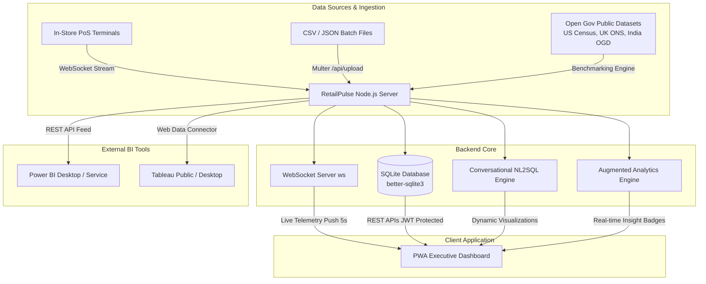

# 🏪 RetailPulse — Interactive Executive KPI Monitoring System
### Real-Time WebSocket Streaming, Mobile PWA, Augmented Analytics (NL2SQL) & Open Gov BI Validation

[](https://nodejs.org/)
[](https://github.com/websockets/ws)
[](https://web.dev/progressive-web-apps/)
[](#research-alignment)

---

## 📌 Executive Summary

**RetailPulse** is an enterprise-grade full-stack business intelligence platform that addresses real-time executive decision-making across retail store chains. The platform incorporates:
1. **WebSocket-Driven Streaming Telemetry**: Millisecond-level KPI updates (revenue velocity, transaction rates, average basket size, customer footfall) pushed from server to client without polling.
2. **Mobile-Responsive Progressive Web App (PWA)**: Standalone installation, service worker offline caching, touch gestures, and reactive layout designed for executive tablets and smartphones.
3. **Augmented Analytics & Automated Insights**: Autonomous statistical anomaly detection, momentum tracking, and executive action recommendations aligned with recent BI literature (2023–2025).
4. **Conversational NL2SQL Interface**: Translates natural language executive queries into validated SQLite syntax, executing in under 10 ms with dynamic chart and tabular rendering.
5. **Open Government Dataset Cross-Validation**: Validated against public retail benchmarks from the **US Census Bureau (MRTS)**, **UK Office for National Statistics (ONS)**, **India Open Government Data (OGD)**, and **Eurostat**.
6. **Power BI & Tableau Public Interoperability**: Live REST/OData endpoints and copyable production DAX measures and Tableau calculated fields.
7. **Secure Auth & File Ingestion**: JWT + bcrypt authentication with role-based access control (Admin, Manager, Analyst) and drag-and-drop CSV/JSON upload pipelines that broadcast updates live to all connected dashboards.

---

## 🏛️ System Architecture



---

## 🚀 Key Features

### 1. Executive Dashboards & KPI Monitoring
- **Executive Overview**: High-level KPIs with delta indicators (vs. prior periods), daily revenue trends, merchandise category doughnuts, and regional cluster comparisons.
- **Sales Analytics**: Deep-dive into transaction volume distributions, category basket radar charts, and units sold polar areas.
- **Store Performance**: Store ranking leaderboard with manager accountability metrics, regional badges, and horizontal store revenue comparisons.
- **Live Telemetry Monitor**: Visual pulse indicators, flashing updates, 20-point rolling live revenue stream, and real-time WebSocket packet event logs.

### 2. Augmented Analytics & Conversational NL2SQL
- **Automated Insights**:
  - *Revenue Momentum*: Automated period-over-period growth rates.
  - *Category Dominance*: Autonomous detection of volume and gross margin leaders.
  - *Weekend Surge Velocity*: Computes Saturday/Sunday footfall lifts.
  - *Outlier & Risk Alerts*: Identifies underperforming locations for proactive intervention.
- **NL2SQL Query Engine**:
  - Type plain-text prompts (e.g. `"Top 5 stores by total revenue"`, `"Category sales breakdown"`, `"Regional revenue"`).
  - Inspect generated SQL queries with syntax highlighting and sub-10ms execution metrics.
  - Interactive dynamic charts and sortable data tables.

### 3. Open Government Dataset Validation (Power BI / Tableau)
- **Empirical Validation**: Benchmarks live retail cluster metrics against:
  - *US Census Bureau*: Monthly Retail Trade Survey (MRTS).
  - *UK Office for National Statistics (ONS)*: Retail Sales Index.
  - *India Open Government Data Platform (OGD)*: CPI Retail Index.
  - *Eurostat*: NACE Rev. 2 Sector Trade Indices.
- **BI Connectors**:
  - Live Web URL endpoints for Power BI `Get Data -> Web` and Tableau `Web Data Connector`.
  - Ready-to-copy DAX expressions (SameStoreSalesGrowth, BasketPenetrationRate).
  - Tableau calculated field formulas (Store Velocity Tier, Revenue Variance %).

### 4. File Upload & Ingestion
- Upload CSV or JSON files with drag-and-drop support and progress animation.
- Automatic schema validation and transactional ingestion into the sales database.
- **Instant WebSocket Broadcast**: Once a file is uploaded, all connected dashboards instantly update without reloading!

### 5. Multi-Role Authentication & Security
- User registration and login protected by **bcrypt** password hashing and **JWT** session tokens.
- Role-Based Access Control (Admin, Manager, Analyst).
- Default demo accounts pre-seeded for instant evaluation:
  - **Administrator**: `admin` / `Admin@123`
  - **Business Analyst**: `analyst` / `Demo@123`

---

## 💻 Tech Stack

| Tier | Technologies |
|---|---|
| **Backend Runtime** | Node.js (v24.x), Express 4.x |
| **Real-time Protocol** | WebSocket (`ws` library) |
| **Embedded Database** | SQLite (`better-sqlite3` v12 with prebuilt binaries) |
| **Authentication** | JSON Web Tokens (`jsonwebtoken`), `bcryptjs` |
| **File Processing** | `multer`, `csv-parse` |
| **Frontend UI** | HTML5, Modern CSS Variables, Glassmorphism, Vanilla JS |
| **Visualizations** | Chart.js 4.4 (Line, Bar, Doughnut, Radar, PolarArea) |
| **PWA Features** | Web App Manifest (`manifest.json`), Service Worker (`sw.js`) |

---

## 🏃 Quick Start Guide

### Prerequisites
- Node.js (v18 or newer recommended, verified on Node v24)
- NPM or PNPM

### 1. Installation
```powershell
cd "c:\Users\M Kumar\OneDrive\main project final"
npm install
```

### 2. Start Server
```powershell
node server.js
```

### 3. Open Dashboard
Open your browser and navigate to:
```
http://localhost:3000
```

### 4. Login Credentials
- **Admin**: `admin` / `Admin@123`
- **Analyst**: `analyst` / `Demo@123`

---

## 📁 Project Structure

```
├── .env                       # Environment configuration (PORT, JWT_SECRET)
├── package.json               # Dependencies and execution scripts
├── server.js                  # Express application and WebSocket broadcast server
├── db/
│   └── database.js            # SQLite schema init, migrations & 90-day seed data
├── routes/
│   ├── auth.js                # Login, register, profile & user management routes
│   ├── data.js                # KPIs, trends, categories, insights, NL2SQL & benchmarks
│   └── upload.js              # Multer CSV/JSON upload handler with live sync
├── services/
│   └── kpiSimulator.js        # Autonomous WebSocket telemetry generator (5s interval)
├── public/
│   ├── index.html             # Login and Registration portal
│   ├── dashboard.html         # Main Executive PWA Dashboard
│   ├── manifest.json          # PWA Web App Manifest
│   ├── sw.js                  # PWA Service Worker with offline caching
│   ├── css/
│   │   └── style.css          # Modern dark-mode responsive glassmorphic stylesheet
│   ├── js/
│   │   └── dashboard.js       # Complete dashboard controller, WS client & Chart.js logic
│   └── icons/
│       ├── icon-192.png       # PWA icon 192x192
│       └── icon-512.png       # PWA icon 512x512
├── sample_data/
│   ├── monthly_retail_sales_2024.csv    # Ready-to-upload retail sales dataset
│   └── open_gov_retail_benchmark.csv   # Open government benchmark test dataset
└── README.md                  # Comprehensive project documentation
```

---

## 📖 Research Alignment

This project adheres to themes in contemporary Business Intelligence and Augmented Analytics research (IEEE, Springer, Elsevier, Wiley 2023–2025):
- *Real-Time Telemetry*: Eliminating polling latency via persistent bidirectional WebSocket connections.
- *Augmented Analytics*: Replacing static historical reporting with automated descriptive and diagnostic insight generation.
- *Conversational Interfaces*: Democratizing SQL query generation for non-technical retail executives.
- *Open Data Grounding*: Validating proprietary enterprise metrics against standardized government economic indicators.
